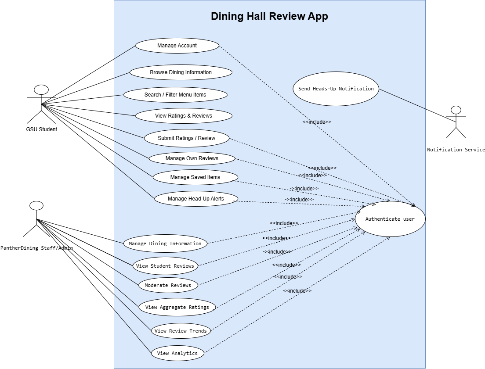

## Architecture and Tech Decisions

The recommended architecture is a three-tier web architecture: presentation layer, application/API layer, and relational data layer. This matches the team's separation of frontend, backend, database, and testing responsibilities.
| **Layer/Technology** | **Choice** | **Reason** |
|----------------------|------------|------------|
| Frontend | React + JavaScript/TypeScript + HTML/CSS + Vite | Build the responsive GUI, navigation, search/filter controls, review forms, saved-item screens, and staff dashboard. |
| Backend | Java + Spring Boot + Spring MVC | Implement authentication/authorization, review rules, filtering, aggregation, saved items, heads-up logic, and admin functions. |
| Database | PostgresSQL | Store normalized relational data for users, halls, stations, items, reviews, tags, saved items, availability, and notification events. |
| Data Access | Spring Data JPA / Hibernate | Map Java domain objects to relational tables and reduce repetitive database-access code |
| Frontend Testing | Vitest, Testing Library, Playwright | Test frontend components and browser workflows. |
| Backend Testing | JUnit + Spring Boot Test with H2 | Test business rules, API endpoints, integration behavior, and critical UI workflows. Run backend tests against an in-memory H2 database configured in PostgreSQL compatibility mode, without touching shared PostgreSQL instance. |
| Version Control | Git/GitHub | Coordinate team development, code review, and configuration management. |
| Secrets | Doppler | Supply shared development database credentials to authorized team members without committing credentials. |
| Deployment/Cloud | Cloud-hosted application and managed PostgresSQL instance | Provide a shared environment for the team and final demonstration, exact provider can be selected based on course constraints. |
| Notifications | Email or browser notification provider | Deliver heads-up alerts, provider choice depends on available project infrastructure. |
### Flow
Student/Staff browser -> React/Vite frontend -> Spring Boot REST API -> PostgreSQL database

Spring Boot applies authorization and business rules before reading or modifying database records.

Each dining hall's weekly schedule is stored as JSON in PostgreSQL. The application defines the JSON structure and interprets it. Each menu item has its own availability start and end time fields. The application evaluates the item-level time window in the context of the dining hall's weekly schedule when displaying availability and processing Heads-Up subscriptions.

Heads-up scheduler/service checks scheduled menu availability against active subscriptions and sends notifications through the selected notification service.

Doppler injects the database environment variables into the backend process for authorized team members. Secret values are not stored in Git or hard-coded in application configuration.

Backend tests use the in-memory H2 test datasource configured in app/src/test/resources/application-test.yaml; they are intended to run without connecting to the shared PostgreSQL database.

Staff analytics are generated from stored review history and aggregate queries rather than from manually collected feedback.

## Use Case Diagram

The following UML use case diagram shows the primary roles and tasks
within the Dining Hall Review App. The main actors are GSU Student,
PantherDining Staff/Admin users, and the external Notification Service.

**Schema Diagram**

